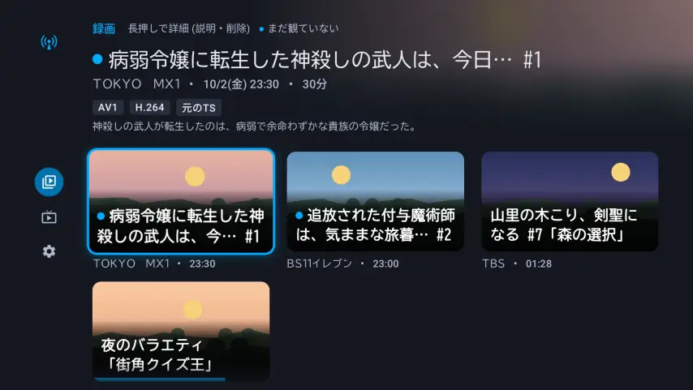
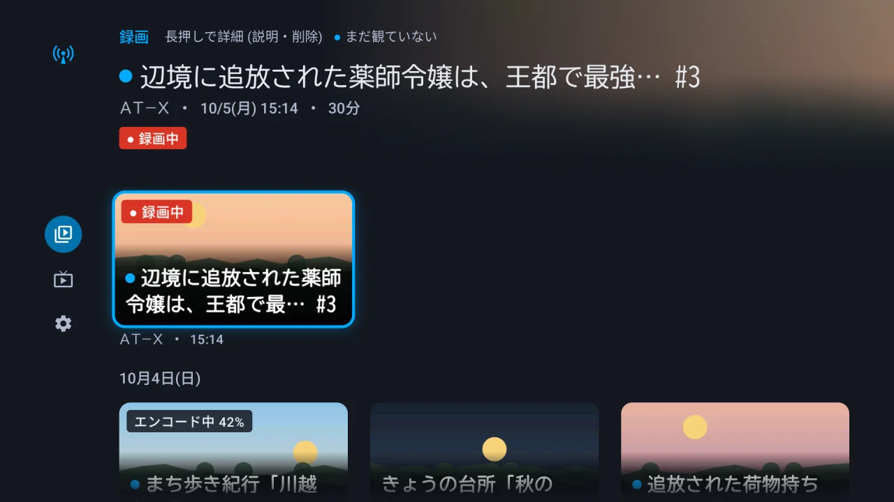
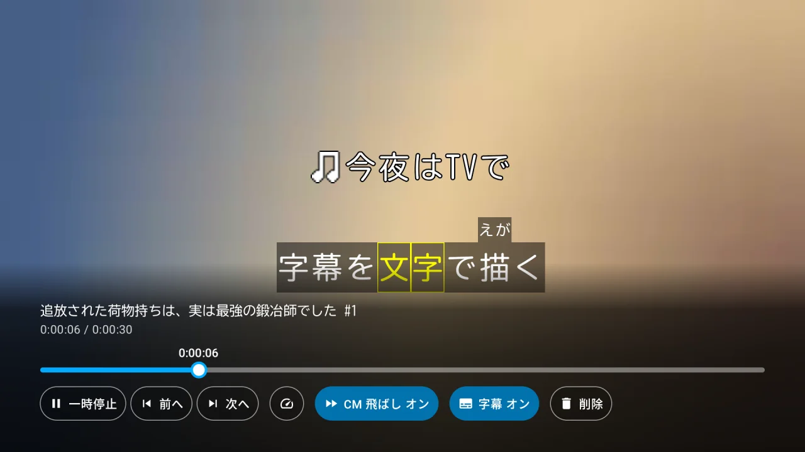
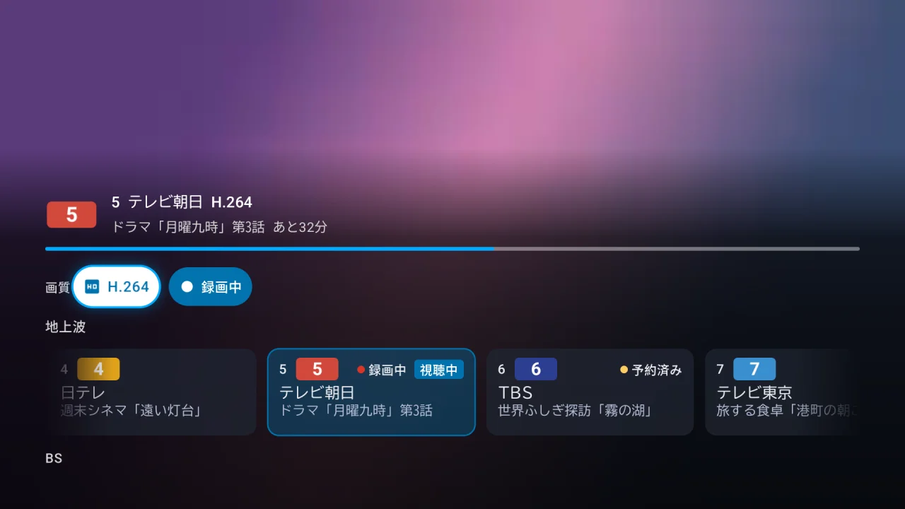
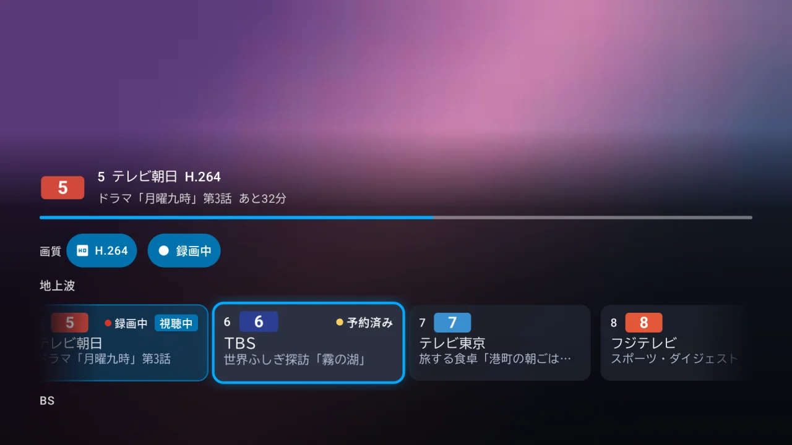

# denpa TV

[denpa](https://github.com/danything/denpa) を Android TV / Google TV で観るアプリです (Jetpack Compose for TV)。
録画 (続きから・CM 飛ばし・追っかけ再生)、ライブ (局の切り替え・録画)、字幕と音声の切り替えができます。

<p align="center">
  
</p>

| 録画 | 録画の再生 (下キー) |
| --- | --- |
|  |  |
| **ライブのメニュー** (下・決定) | **局の列** (上キー) |
|  |  |

画像は作り物の番組を返す偽の denpa で撮ったものです。ほかの画面と動きは [docs/usage.md](docs/usage.md)。

## 入れ方

Play ストアにはまだ無いので、パソコンから adb で入れます。テレビの開発者向けオプションでデバッグを有効にしてから:

```sh
curl -fsSL https://raw.githubusercontent.com/danything/denpa-tv/main/scripts/install.sh | bash -s -- <テレビの IP>
```

Windows・テレビ側の準備・ワイヤレス デバッグのペア設定は [docs/install.md](docs/install.md)。
2回目からはアプリの中で上げられます ([docs/updates.md](docs/updates.md))。

## denpa に繋ぐ

**denpa v1.55.0 以上**が要ります。古ければ録画の一覧の頭と設定に通知が出ます (止めはしませんが、録画を開けません)。

1. 初めて開くと出る QR を、テレビと同じ Wi-Fi のスマホで読む
2. ブラウザで denpa を開いている URL を入れて送る (例: `http://192.168.1.10:3000/`。ポートを省くと 80、3000 の順に試す)
3. 家の LAN の denpa (テレビが `TRUSTED_NETWORKS` の中) ならそれで終わり。家の外の denpa (OIDC) なら、スマホでログインするとテレビが登録されて進む

接続先を変える・登録を外すのは左のメニューの「設定」から。リモコンで URL を打つ・安全のことは [docs/pairing.md](docs/pairing.md)。

## リモコン

十字キーと決定・戻るだけで全部に届きます。

| キー | ライブ | 録画・追っかけ再生 |
| --- | --- | --- |
| 左 / 右 | 前 / 次の局 | 10 秒戻す / 送る |
| 下・決定 | メニュー (操作の列と局の列) | 下: シークバーと操作の列。決定: 止める・動かす |
| 上 | 局の列 (いまの局にフォーカス) | 操作の列 |
| 決定の長押し | 番組の詳細 | 番組の詳細 |
| 戻る | 閉じる。何も無ければいちばん上のメニューへ | 閉じる。何も無ければ一覧へ |
| CH+ / CH- | 次 / 前の局 | — |
| 情報 | 番組の詳細 | 番組の詳細 |
| 数字 | その番号 (リモコン番号) の局へ。0 は 10。同じ番号は、いま観ている地上波 / BS のほう | — |

Menu・メディアキー・緑のボタンと、メニューの中のキーは [docs/controls.md](docs/controls.md)。

## ドキュメント

- [docs/usage.md](docs/usage.md) — 画面ごとの動き (ライブ・録画・追っかけ再生・字幕と音声・リンクで開く・できないこと)
- [docs/controls.md](docs/controls.md) — キーの全部と、そう決めた理由
- [docs/playback.md](docs/playback.md) — 再生できる形式・MPEG-2・切れたときの繋ぎ直し
- [docs/pairing.md](docs/pairing.md) — denpa に繋ぐ (詳しい手順・安全のために)
- [docs/install.md](docs/install.md) / [docs/updates.md](docs/updates.md) — adb で入れる / アプリの中で上げる
- [docs/development.md](docs/development.md) — ビルド・テスト・スクリーンショット ([libraries.md](docs/libraries.md)・[release.md](docs/release.md))

## 謝辞

- [@kametani-mikihiro](https://github.com/kametani-mikihiro) — Android TV 12 (BRAVIA) で再生すると落ちるのを、ログ付きで2度報告してくれました (#24)

マージした PR を書いてくれた人はここに載せます。手を入れる前に [CONTRIBUTING](.github/CONTRIBUTING.md) を
見てください。不具合・要望は [Issue](https://github.com/danything/denpa-tv/issues/new/choose) へ。

## ライセンス

[GNU Affero General Public License v3.0](LICENSE) (denpa と同じ)。ただし:

- `app/src/main/java/io/nayuki/qrcodegen/` は [Project Nayuki の QR Code generator](https://www.nayuki.io/page/qr-code-generator-library) を取り込んだもので **MIT License** (各ファイルの頭の表示のまま)
- 字幕と放送の字 ([Denpa Font](https://github.com/danything/denpa-font)。ビルドのときに取ってきて APK に入れる) は **SIL Open Font License 1.1**
